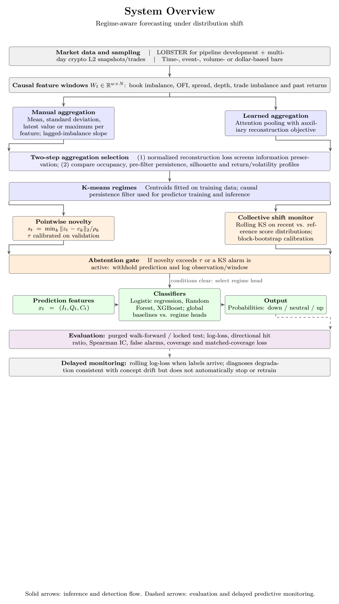

# Regime-Aware Order Book Forecasting Under Distribution Shift

Perceptron Hackathon 2026 — Theme 3: Markets & Trading Intelligence — Problem 4.

This repository implements a regime-aware pipeline for short-term mid-price forecasting. Noisy order-book events are compressed into latent states that should persist (AAABBB, not ABABAB) and remain useful for predicting price moves. The system also detects when training conditions no longer hold: **covariate shift** (feature distributions change) and **concept drift** (the feature–future-return link changes).

The approach is a multi-step evaluation framework for aggregation functions, not a new pooling operator. Fixed manual encodings and learned attention pooling are compared under the same protocol.

## Approach

1. **Representation selection.** Each window \(W_t \in \mathbb{R}^{w \times N}\) holds causal book features (imbalance, OFI, spread, depth, trade imbalance, past returns). Manual statistics and learned attention / VAE pooling are screened first by reconstruction loss, then by cluster occupancy, persistence, silhouette, and regime-conditioned return/volatility.
2. **Unknown states and shifts.** K-means centroids are fit on training latents. Pointwise novelty \(s_t = \min_k \|z_t - c_k\|_2 / \rho_k\) and a rolling KS test on novelty scores trigger **abstention** when a window is unknown or the score distribution has shifted.
3. **Prediction.** Horizon labels \(y_{t+h} \in \{-1, 0, +1\}\) are built from log mid-price returns versus a causal volatility threshold. Features \(x_t = (I_t, Q_t, C_t)\) (book imbalance, aggressive-trade imbalance, cumulative log-return) feed global and regime-conditioned classifiers. Predictions are withheld while novelty or a KS alarm is active.

Development uses LOBSTER sample data; multi-day crypto L2 recordings test temporal generalization.

## System overview

The diagram below is page 2 of [`optiver_submission_v9.pdf`](optiver_submission_v9.pdf). Solid arrows are the inference and detection flow; dashed arrows are evaluation and delayed predictive monitoring.



## Repository structure

```
.
├── src/                          Python modelling pipeline
│   ├── orbderbook_pipeline.py    LOBSTER load, causal features, bar windows, splits
│   ├── aggregation.py            Manual aggregations and candidate combinator
│   ├── nn.py                     Decoder, VAE / attention encoder, train–select loops
│   ├── eval_cluster.py           Persistence, silhouette, regime-return diagnostics
│   ├── filter.py                 Novelty scores, τ calibration, rolling KS gate
│   ├── prediction.py             Downstream classifiers (in progress)
│   └── eval_system.py            End-to-end evaluation (in progress)
├── binance_orderbook/            Rust recorder for Binance L2 snapshots + trades
├── evaluation_1_1/               Saved manual-aggregation selection runs
├── note.ipynb                    Exploratory training and clustering notebook
├── docs/system_overview.png      Scheme extracted from the submission PDF
├── optiver_submission_v9.pdf     Full write-up
└── implementation_plan.md        Internal stage-1 / stage-2 checklist
```

| Module | Role |
|---|---|
| `orbderbook_pipeline.py` | Builds mid-price, imbalance, spread, trade imbalance, and sliding windows; train/validation/test splits. |
| `aggregation.py` | Fixed statistics (`mean`, `std`, `min`, `max`, …) applied per feature; grid of manual candidates. |
| `nn.py` | Shared decoder plus `ManualAggregation` / `VAEEncoder` autoencoders; reconstruction (+ KL for the VAE) and phase-1 candidate registration. |
| `eval_cluster.py` | Cluster persistence (turnover / mean duration), silhouette, KS on regime returns. |
| `filter.py` | Causal majority filter, centroid dispersion, novelty \(s_t\), rolling KS abstention. |
| `binance_orderbook/` | Trade-synchronised best-bid/ask + trade CSV recorder (see its [README](binance_orderbook/README.md)). |

## Setup

Python 3.13+, [uv](https://docs.astral.sh/uv/):

```bash
uv sync
```

LOBSTER sample files live in `LOBSTER_SampleFile_AMZN_2012-06-21_10/`. The Binance recorder is built with Cargo; see `binance_orderbook/README.md`.
