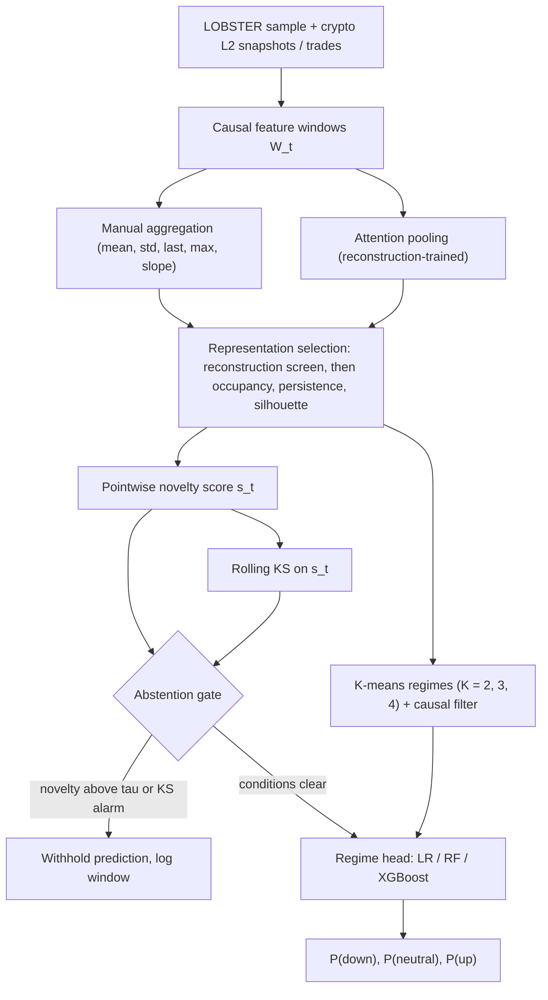

# Regime-Aware Order Book Forecasting Under Distribution Shift

Perceptron Hackathon 2026 (Optiver × IIT Bombay, Techfest) · Theme 3 — Markets & Trading Intelligence · Problem 4 — *Order Book Forecasting Under Regime Shifts*

**Author:** Arsène Ducrocq (solo entry) · [GitHub](https://github.com/<your-handle>) · [Medium](https://medium.com/@<your-handle>)
**Status:** work in progress, started 15 October 2026 (see [Status](#7-status)). Results are added as they are produced; nothing below is claimed as a result unless it appears in the *Results* section.
**Round 1 abstract:** [`docs/abstract.pdf`](docs/abstract.pdf) — this README holds the implementation detail that the word limit of the abstract does not allow.

---

## TL;DR

Order-book forecasting is not only about predicting the next mid-price move: it is also about knowing, online and without lookahead, when the conditions the model was fitted on no longer hold. This project builds a pipeline that

1. summarises sliding order-book windows into a compact state,
2. clusters those states into **persistent, predictive regimes**,
3. **abstains** when the current state is unfamiliar or when the distribution of novelty scores shifts,
4. otherwise predicts a 3-class short-horizon mid-price move with a regime-conditioned head.

The contribution is an **evaluation framework**, not a new clustering algorithm: regimes are judged by downstream predictive value, pointwise novelty and collective shifts are treated separately, and abstention is assessed at matched coverage against random and volatility-based baselines.

## Contents

1. [Scope and non-goals](#1-scope-and-non-goals)
2. [Pipeline in detail](#2-pipeline-in-detail)
3. [Evaluation protocol](#3-evaluation-protocol)
4. [Design decisions and alternatives](#4-design-decisions-and-alternatives)
5. [Repository layout](#5-repository-layout)
6. [Getting started](#6-getting-started)
7. [Status](#7-status)
8. [Limitations and risks](#8-limitations-and-risks)
9. [References](#9-references)

---

## 1. Scope and non-goals

**In scope**

- Short-horizon (seconds to about a minute) mid-price move classification from order-book features.
- Regime discovery that is *persistent* (AAABBB rather than ABABAB) and *predictive*, not merely well-clustered.
- Detection of unfamiliar states (pointwise) and of collective shifts (distributional), with a defined system reaction: withhold the prediction.

**Non-goals**

- This is **not a trading system**. There is no PnL, Sharpe or execution model. A permanent shift shows up as sustained abstention and is reported through coverage, not hidden.
- No online retraining. Unknown windows are logged; any recovery through new regimes is an offline analysis (stretch goal).
- No new clustering algorithm.

---

## 2. Pipeline in detail

### 2.1 Data and sampling

- **LOBSTER sample** (a single trading day): used to develop and test the pipeline end to end.
- **Self-recorded crypto L2 snapshots and trades** over several days: used to test temporal generalisation and to obtain natural shifts.
- Bars (time, event-count, volume or dollar) are chosen by inspecting representative samples rather than being optimised jointly with the model parameters.

### 2.2 Features

Each window $W_t \in \mathbb{R}^{w \times N}$ stacks the last $w$ observations of $N$ standardised features: book imbalance, order-flow imbalance (OFI), spread, depth, trade imbalance and past returns.

**Scalers are fitted on the training period and frozen on validation and test.** A rolling normalisation would silently absorb exactly the covariate shift the system is supposed to detect.

Predictor inputs (three features, computed over the last $n$ bars):

$$
I_t = \frac{1}{n}\sum_{i=t-n+1}^{t}\frac{V^b_i - V^a_i}{V^b_i + V^a_i},\qquad
Q_t = \frac{B_t - S_t}{B_t + S_t},\qquad
C_t = \log\frac{p_t}{p_{t-n}}
$$

with $V^b_i, V^a_i$ the bid/ask depth summed over the top $L_b$ levels, $B_t, S_t$ the aggressive buy/sell volume over the last $n$ bars, and $p_t$ the mid-price.

### 2.3 Stage 1 — Representation selection

Two ways of turning a window into a fixed-size vector are compared.

**Manual aggregation.** For each feature $j$, a statistic $g_j \in \{\text{mean}, \text{std}, \text{last}, \text{max}\}$ is applied to the window, and one cross-feature term is appended: the within-window slope of returns on lagged imbalance,

$$
f(W) = \big(g_1(W_{\cdot 1}),\dots,g_N(W_{\cdot N}),\ \hat\gamma(W)\big),\qquad
\hat\gamma(W)=\frac{\widehat{\mathrm{Cov}}(I_{1:w-1},\,r_{2:w})}{\widehat{\mathrm{Var}}(I_{1:w-1})}.
$$

The slope is label-free (it only uses returns already observed inside the window) and gives the representation a handle on the *feature–return relation*, not only on feature levels.

**Learned aggregation.** Attention pooling: a learned query pools the rows of the encoded window. Initial sizes (to be tuned on validation, the data is small by design): $d_m = 64$, $n_h = 4$ heads, $n_{enc} = n_{dec} = 2$ blocks, latent dimension $d = 8$.

**Fair comparison.** Both paths use the same latent dimension and a comparable decoder that reconstructs the original window; the manual vector is projected to the latent dimension. The normalised reconstruction error

$$
\ell_{rec}(f) = \frac{1}{wN}\,\mathbb{E}\,\big\lVert W_t - \hat W_t \big\rVert_F^2
$$

is measured on the same target for every candidate.

**Selection funnel.** Reconstruction error is only a **screen** for information preservation. It says nothing about persistence or predictive value, and a learned encoder will tend to win it. Candidates are therefore assessed, in order, on:

1. reconstruction error (screen),
2. cluster occupancy, temporal persistence measured **before** causal filtering, and separation (silhouette),
3. downstream predictive evaluation (Stage 3).

Return/volatility distributions, autocorrelation, feature–future-return relations and time-of-day dependence per cluster are secondary diagnostics only.

**Regimes.** K-means with $K \in \{2,3,4\}$ on the latent vectors $z_t$.

**Causal persistence filter.** Raw labels $\hat k_t = \arg\min_k \lVert z_t - c_k\rVert$ can flip between consecutive windows. A trailing majority vote over the last $m$ labels,

$$
r_t = \arg\max_k \sum_{u=t-m+1}^{t} \mathbb{1}[\hat k_u = k],
$$

removes isolated flips at the price of roughly $m/2$ windows of delay ($m$ tuned on validation). It is used consistently in predictor training and inference, but **excluded from the structural persistence metrics** so that it cannot inflate them.

*Variational bottleneck (KL-regularised latent) is a stretch goal; the MVP trains a deterministic autoencoder objective.*

### 2.4 Stage 2 — Unknown states and shifts

**Pointwise novelty.** Distance to the nearest centroid, normalised by that cluster's training dispersion:

$$
s_t = \min_k \frac{\lVert z_t - c_k\rVert_2}{\rho_k},\qquad
\rho_k = \Big(\frac{1}{|C_k|}\sum_{z\in C_k}\lVert z-c_k\rVert_2^2\Big)^{1/2}.
$$

Centroids and dispersions are fitted on training data; the threshold $\tau$ is calibrated on chronological validation scores. An observation is **unknown** if $s_t > \tau$ or if it is assigned to a regime with insufficient training support (seen fewer than $n_{min}$ times).

**Collective shift.** A rolling two-sample Kolmogorov–Smirnov test compares the last $L$ scores with a reference score distribution, $D_t = \sup_x |\hat F_{t,L}(x) - \hat F_{ref}(x)|$. The alarm threshold is calibrated by **block bootstrap on stable validation data** (scores are autocorrelated, so i.i.d. critical values would understate false alarms), and **false alarms per hour** are reported.

**Abstention gate.** While either condition is active, predictions are withheld and the window and score are logged. Prediction resumes once both conditions clear. A persistent shift therefore means sustained abstention; recovery through new regimes remains offline.

**Delayed monitoring.** Rolling log-loss is tracked once labels arrive at horizon $h$. A sustained degradation may indicate concept drift, but it is a diagnostic: it triggers no automatic stop or retraining.

### 2.5 Stage 3 — Prediction

**Target.** For horizon $h$, the 3-class label $y_{t+h}\in\{-1,0,+1\}$ says whether $\log(p_{t+h}/p_t)$ falls below, stays within, or exceeds $\pm\kappa\,\hat\sigma_{t,h}$, where $\hat\sigma_{t,h}$ is a causal volatility estimate **for that horizon**.

**Horizon.** Development explores $h = 1$–$60$ seconds. One primary horizon is locked **before** the final test.

**Models.** Multinomial logistic regression (reference), Random Forest and XGBoost, each trained both as a global model and as regime-conditioned heads, with the same features, splits and a limited validation tuning budget. For logistic heads, regime $k$ uses

$$
\eta_{k,c}(x_t)=\alpha_{k,c}I_t+\beta_{k,c}Q_t+\theta_{k,c}C_t+\varepsilon_{k,c},\qquad
\Pr(y_{t+h}=c\mid x_t,r_t=k)=\frac{e^{\eta_{k,c}(x_t)}}{\sum_{c'}e^{\eta_{k,c'}(x_t)}}.
$$

**Leakage control.** Features are causal. Labels whose horizon crosses a train/validation/test boundary, or a regime segment, are **purged**; heads are trained on contiguous regime segments only, so the last return of one segment is never paired with the first of the next.

**Output.** Class probabilities are primary. An expected return built from training-period class means is secondary.

---

## 3. Evaluation protocol

**Splits.** Purged chronological walk-forward with a locked test period. Encoders, scalers and centroids are fitted on training data; thresholds on validation.

| Metric | Role |
|---|---|
| Log-loss | Primary |
| Directional hit ratio on accepted, non-neutral outcomes | Secondary (expected to sit near 50 %) |
| Spearman IC | Secondary |
| Block-bootstrap confidence intervals | Reported for all of the above |

**Controls** (each answers one specific question):

| Control | Question it answers |
|---|---|
| Global linear and non-linear models | Do regimes add value beyond model complexity? |
| Regime-specific class priors | Are gains only due to different class frequencies per regime? |
| Block-permuted regime labels | Is the gain more than extra capacity from several heads? |
| Time-of-day regimes (same $K$) | Does the model learn more than the clock? |

**Shift metrics.** Detection delay on known events, false alarms per hour in calm periods, performance around shifts, and prediction coverage.

**Abstention.** Assessed by coverage and by **matched-coverage log-loss** versus random abstention and volatility-based abstention. Comparing log-loss only on the covered subset would be biased by selection.

Controlled (synthetic) shifts supplement the natural ones but are **always reported separately** from real-market evidence.

---

## 4. Design decisions and alternatives

| # | Decision | Rationale | Alternative considered |
|---|---|---|---|
| 1 | Reconstruction error is a *screen*, not the selection criterion | It measures information preserved, not persistence or predictive value; a learned encoder wins it almost by construction | Select the representation by reconstruction alone |
| 2 | Hand-written aggregation includes a within-window slope of returns on lagged imbalance | Gives regimes a label-free signal about the feature–return relation, a partial answer to concept drift that distance-to-centroid cannot see | Feature levels only |
| 3 | K-means with small $K$ ($2$–$4$) | Centroids directly provide the novelty score and the support count; small $K$ keeps regimes populated on a one-day LOBSTER sample | DBSCAN, Gaussian mixtures |
| 4 | Causal trailing-argmax filter | Enforces AAABBB persistence without lookahead, at a known ~$m/2$ delay | Non-causal smoothing (leaks the future) |
| 5 | Heads trained on contiguous regime segments, with purging | Prevents pairing the last return of one segment with the first of the next | Random shuffling of windows |
| 6 | **Abstain** instead of falling back to a global model | A global model is fitted on the same distribution, so it is no more reliable out of distribution; no head can be trained on data that is out of distribution by definition | Global fallback on KS alarm |
| 7 | No online retraining | The system is an evaluation framework; permanent shifts must be visible in coverage rather than patched | Rolling or KS-triggered retraining |
| 8 | Scalers frozen after training | Rolling normalisation would hide covariate shift | Rolling standardisation |
| 9 | No seasonal adjustment | One LOBSTER day is not enough for a clean intraday profile; opening and closing form their own regimes. Time-of-day regimes are used as a control instead | Deseasonalised features |
| 10 | Prediction-quality metrics, no PnL | PnL depends on execution and fee assumptions that would dominate the result; the question here is whether regimes help prediction and whether the system knows when to stop | PnL, Sharpe, Sortino |
| 11 | Three classifiers, one pipeline | Logistic regression is the reference; Random Forest and XGBoost act as global non-linear controls. They share features, splits and tuning budget, so the comparison is controlled | Logistic regression only |
| 12 | Rolling log-loss is a diagnostic only | It arrives `h` steps late and cannot trigger a safe real-time reaction | Automatic alarm on degradation |
| 13 | Mixture of experts left as future work | Fair comparison between linear and neural heads comes first | Learned gating in the MVP |

---

**Data**

- LOBSTER sample: download the free sample from [lobsterdata.com](https://lobsterdata.com) and place it in `data/lobster/`.
- Crypto L2 snapshots and trades: `TODO: recorder command and exchange/feed used`.

---

## 5. Status

Work started on **15 October 2026**, with a six-week target and a short buffer before the **1 December 2026** Midway Check.

| Weeks | Focus |
|---|---|
| 1–2 | Data pipeline and baselines |
| 3–4 | Representation, detection and prediction |
| 5–6 | Evaluation and polish |

**Minimum viable system**

- [ ] Data pipeline (LOBSTER) and causal feature windows
- [ ] Manual aggregation and attention pooling, with the selection funnel
- [ ] K-means regimes and causal filter
- [ ] Distance-based abstention
- [ ] Rolling KS monitoring with block-bootstrap calibration
- [ ] Logistic regression, Random Forest and XGBoost (global and regime-conditioned)
- [ ] Purged walk-forward evaluation with controls

**Stretch goals**

- [ ] Offline analysis of logged unknown observations (similarity, recurrence, return behaviour)
- [ ] Cross-feature statistics (e.g. OFI–return correlation, book-versus-trade imbalance differences)
- [ ] Variational bottleneck
- [ ] Latent-input neural heads
- [ ] Inference-latency benchmark

### Results

*To be filled in as experiments complete (log-loss with confidence intervals, coverage and matched-coverage curves, detection delay and false alarms per hour).*

---

## 8. Limitations and risks

- **Few natural shifts in one LOBSTER day.** Multi-day crypto recordings and separately reported controlled shifts address this.
- **Clusters may only recover the time of day.** Time-of-day regimes and the normalised mutual information with time buckets are used as a control.
- **Weak predictive gains are expected** (hit ratio near 50 %). The project tests adaptation and abstention, not alpha.
- **KS on autocorrelated scores.** Thresholds come from block-bootstrap calibration on validation periods that must be identified as stable; this definition is part of the calibration protocol.
- **The within-window slope is noisy for small $w$** and measures the relation at a one-step lag, which may differ from the relation at horizon $h$.

---

## 9. References

- M. López de Prado, *Advances in Financial Machine Learning*, Wiley, 2018 (bar types, purged walk-forward validation).
- R. Cont, A. Kukanov, S. Stoikov, "The Price Impact of Order Book Events", *Journal of Financial Econometrics*, 2014 (order-flow imbalance).
- LOBSTER limit order book data: [lobsterdata.com](https://lobsterdata.com).

---

